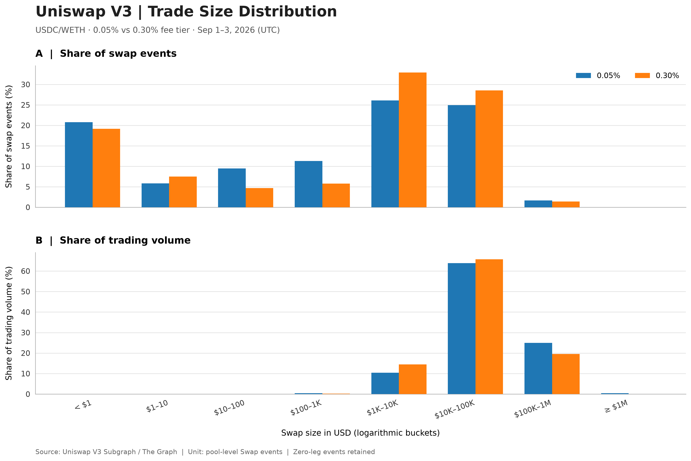
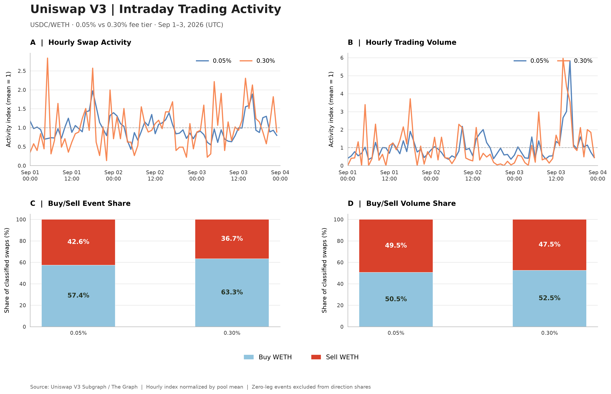
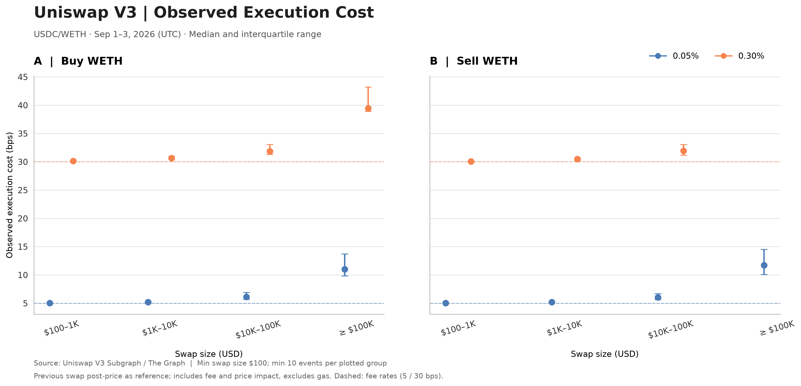
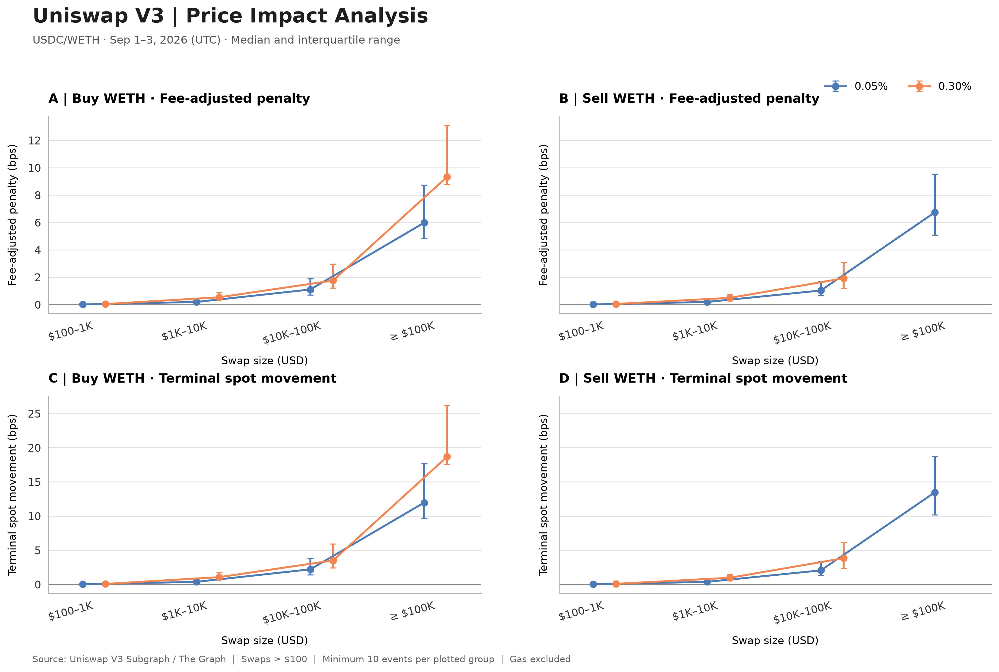
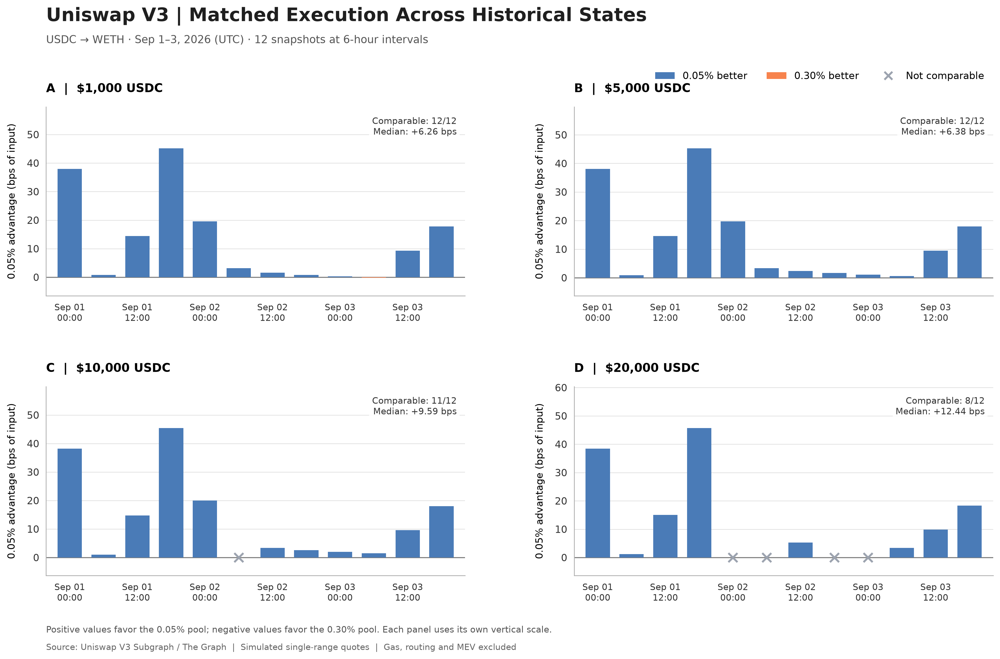

# DEX Trading & Liquidity Intelligence

### On-chain Data Engineering | DeFi Market Analytics | Execution Intelligence

An end-to-end analytics project examining trading activity, liquidity conditions, and execution quality across Uniswap V3 USDC/WETH liquidity pools on Ethereum Mainnet.

The project combines on-chain data engineering, financial analytics, and historical execution simulation to investigate how fee tiers, liquidity, and pool prices affect DEX trading outcomes.

**Focus:** Uniswap V3 · Ethereum Mainnet · USDC/WETH · 0.05% and 0.30% fee tiers

**Status:** Trading analytics and execution simulation pilot completed; broader research in development.

---

## 1. Project Highlights

- Built a reproducible pipeline for extracting, normalizing, and validating historical Uniswap V3 data using The Graph, Python, and Parquet.
- Processed **21,390 pool-level Swap events** across two fee tiers, with transaction-level identifiers, token flows, execution prices, and pool-state information.
- Reconciled swap-level trading volumes against daily subgraph aggregates across all six pool-day observations.
- Analyzed trade-size distributions, directional trading activity, intraday volume patterns, and observed execution costs.
- Developed a historical matched-order simulation framework to compare execution quotes across fee tiers under the same pool-state snapshot.
- Produced publication-quality visualizations and structured research outputs suitable for further analysis and dashboard integration.

### Selected Results

| Metric | Result |
|---|---|
| Pilot period | September 1–3, 2026 (UTC) |
| Swap events | 21,390 |
| Unique transaction hashes | 20,485 |
| 0.05% pool trading volume | $238.56M |
| 0.30% pool trading volume | $17.90M |
| Median swap size, 0.05% | $1,434 |
| Median swap size, 0.30% | $3,658 |
| Historical execution snapshots | 12 |
| Matched simulated order sizes | $1K, $5K, $10K, $20K |

All results refer to the initial three-day pilot unless otherwise stated.

---

## 2. Trading Activity & Market Structure

The first analysis examines how trading behavior differs across fee tiers.

Key findings:

- The 0.05% pool accounted for substantially more trading volume and Swap events.
- The 0.30% pool had a higher median individual Swap size.
- Transactions between $10K and $100K contributed approximately 64–66% of trading volume in both pools.
- Around 19–21% of Swap events were smaller than $1, contributing negligible trading volume.
- Buy-WETH events were more frequent than Sell-WETH events, while USD trading volumes were relatively balanced.

### Trade Size Distribution



### Intraday Trading Activity



These analyses characterize pool-level trading activity rather than identifying unique economic users or complete router-level orders.

---

## 3. Execution Quality & Price Impact

The execution analysis evaluates how trading costs vary with order size, direction, and pool conditions.

For each observed Swap, the pipeline reconstructs a pre-Swap price reference using the preceding Swap's post-execution pool price.

The analysis distinguishes:

- Nominal swap fees
- Observed execution-price deviations
- Fee-adjusted execution penalties
- End-of-Swap spot-price movements

Observed execution costs generally increased with trade size.

For Buy-WETH transactions of $10K–$100K, the median fee-adjusted execution penalties were:

| Fee tier | Median penalty |
|---|---:|
| 0.05% | 1.11 bps |
| 0.30% | 1.76 bps |

These figures describe observed trades and are not matched-order comparisons.

### Observed Execution Cost



### Price Impact Analysis



---

## 4. Historical Matched Execution Simulation

A historical quoting framework evaluates the same hypothetical USDC-to-WETH order against both liquidity pools at the same Ethereum block.

The simulation uses historical:

- Pool spot prices
- Active liquidity
- Current tick positions
- Fee-tier configurations

This enables controlled comparisons of simulated output amounts across alternative execution venues.

### Initial Findings

Across 12 historical pool-state snapshots sampled at six-hour intervals:

| USDC order | 0.05% wins | Comparable states | Median advantage |
|---|---:|---:|---:|
| $1,000 | 11 | 12 | +6.26 bps |
| $5,000 | 12 | 12 | +6.38 bps |
| $10,000 | 11 | 11 | +9.59 bps |
| $20,000 | 8 | 8 | +12.44 bps |

A positive advantage indicates that the 0.05% pool delivered more WETH for the same simulated USDC input.

The results highlight the importance of evaluating **fee rates, starting pool prices, and liquidity together** when assessing execution venues.

### Matched Execution Across Historical States



The current simulator supports orders that remain within one tick-spacing interval. Larger or boundary-crossing orders are excluded from comparison. Gas costs, router behavior, and MEV are outside the present simulation.

These are hypothetical historical quotes, not realized trading outcomes.

---

## 5. Data Engineering & Analytics Stack

| Component | Technology |
|---|---|
| Blockchain | Ethereum Mainnet |
| Protocol | Uniswap V3 |
| On-chain data access | The Graph / GraphQL |
| Data processing | Python, Pandas, NumPy |
| Local analytical storage | Parquet |
| Visualization | Matplotlib, Plotly |
| Data validation | Event deduplication, schema checks, volume reconciliation |
| Version control | Git / GitHub |
| Development environment | macOS, VS Code, Conda |

The pipeline implements cursor-based pagination, compressed storage, checkpoint recovery, and validation of pool addresses, token ordering, timestamps, and transaction identifiers.

Raw datasets and API credentials are excluded from version control.

---

## 6. Repository Structure

```text
scripts/
    01_pool_daily_overview.py
    02_swap_smoke_test.py
    03_swap_pilot_extraction.py
    04_trade_size_distribution.py
    05_intraday_activity.py
    06_observed_execution_cost.py
    07_price_impact_analysis.py
    08_historical_state_feasibility.py
    09_matched_swap_quote.py
    10_multiblock_quote_study.py
    11_multiblock_quote_visualization.py

reports/
    figures/
    execution_intelligence_pilot.md

docs/
    PROJECT_STATE.md
```

Local data directories contain raw event records, processed Parquet datasets, analytical outputs, and data manifests.

---

## 7. Current Scope & Next Steps

The initial pilot establishes a functional workflow from on-chain extraction to market analysis and historical execution comparison.

Planned extensions include:

1. Broader historical coverage and additional market conditions.
2. Robustness analysis of execution-quality differences.
3. Improved tick-aware historical execution simulation.
4. Liquidity provision and LP performance analysis.
5. Protocol economics and product-level analytics.
6. An interactive analytics dashboard.

The long-term objective is a decision-support framework for understanding DEX trading behavior, liquidity efficiency, and execution quality.

---

## 8. Research Notes

The analyses use actual Uniswap V3 subgraph observations and explicitly labeled historical simulations.

Pool-level Swap events are not equivalent to distinct users or complete economic orders. Observational comparisons may reflect differences in trade selection and market conditions.

Simulation results are conditional on model assumptions and do not represent executable guarantees or investment returns.

Detailed pilot findings are documented in [Execution Intelligence Pilot](reports/execution_intelligence_pilot.md).
