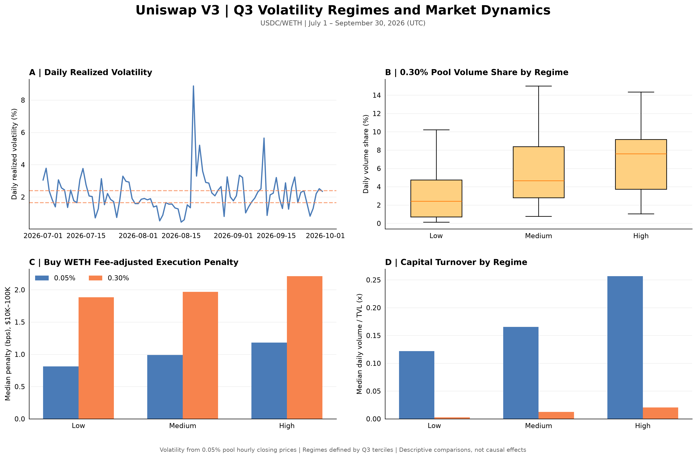

# DEX Trading & Liquidity Intelligence

*Trading, liquidity, and fee-tier competition in Uniswap V3*

Hi, welcome! 👋

I use on-chain data from Uniswap V3 to study trading activity in two USDC/WETH pools on Ethereum. I compare the 0.05% and 0.30% fee tiers, examine execution costs and liquidity, and track how their trading activity changed from July to September 2026. I also built an interactive dashboard to explore the results.

The main question is simple: **How do trading activity, liquidity, and execution costs differ between the two pools?**

**[Read the full report](reports/q3_research_report.md)** · **[Explore the dashboard code](dashboard/app.py)**

## At a glance

| | Scope |
|---|---|
| **Market** | Uniswap V3 USDC/WETH, Ethereum Mainnet, 0.05% and 0.30% fee tiers |
| **Sample** | July 1 to September 30, 2026 (92 days) |
| **Trading data** | 581,454 Swap events and $7.47B in combined trading volume |
| **Data validation** | 184 daily pool partitions, no duplicate event IDs, daily volume reconciliation |
| **Execution analysis** | 374,935 swaps worth at least $100; observed costs and price impact |
| **Liquidity and fees** | Pool TVL, active liquidity, LP Mint/Burn activity, and estimated gross fees |
| **Additional analysis** | Transaction origin activity, volatility regimes, and daily regressions |
| **Dashboard** | Streamlit and Plotly, with date and fee-tier filters |

## Key findings

- **Trading activity:** The 0.30% pool's share of the two pools' trading volume increased from **2.73% in July to 9.70% in September**. Its average Swap size also increased.
- **Execution costs:** The 0.30% pool's median fee-adjusted penalty for $10K–$100K WETH purchases fell from **3.12 bps to 1.55 bps** between July and September. Its total observed execution cost remained higher than the 0.05% pool's.
- **Liquidity:** The 0.30% pool experienced large changes in active liquidity during August. Its median active liquidity index increased from **43.24 to 194.03** when comparing August 10–16 with August 24–30.
- **Fee generation:** The 0.30% pool's share of estimated gross fees rose from **14.4% to 39.2%** across the quarter.
- **Volatility:** The 0.30% pool had a higher volume share on more volatile days. The relationship was positive in the daily regressions, although the main specifications did not reach the 5% significance level.

## 1. Trading activity and market structure

I collected Swap events from both pools and aggregated the data into daily and monthly summaries. The 0.05% pool remained much larger throughout the quarter, but the 0.30% pool gained trading volume share.

| Month | 0.05% volume | 0.30% volume | 0.30% volume share |
|---|---:|---:|---:|
| July | $2.60B | $73.0M | 2.73% |
| August | $2.42B | $131.6M | 5.15% |
| September | $2.03B | $217.7M | 9.70% |


The 0.30% pool's share of Swap events decreased from 9.15% to 7.67% over the same period. Its average Swap size rose from about $4,943 to $11,510. This points to larger trades as an important part of its volume growth.


## 2. Execution costs and price impact

I estimate execution costs using each Swap's execution price and a price reference from the previous recorded Swap. I examine 374,935 events with trade sizes of at least $100.

For WETH purchases between $10K and $100K, the median observed execution costs were **6.03 bps** in the 0.05% pool and **32.18 bps** in the 0.30% pool over Q3. Most of this difference comes from the nominal fee rates of 5 bps and 30 bps.


After removing nominal fees, the 0.30% pool showed lower median execution penalties in September than in July for these trades. The two pools handled different trades at different times, so this is an observational comparison. Gas costs, routing, and MEV are not included.

I also built a small historical quote simulation during the initial three-day pilot. It compares hypothetical orders across both pools at the same block. The simulation covers only orders that remain within one tick-spacing interval. [See the pilot analysis](reports/execution_intelligence_pilot.md).

## 3. Liquidity and LP activity

I compare daily total value locked (TVL) with active liquidity. In Uniswap V3, active liquidity changes as prices move across liquidity ranges. Its raw value is not measured in USD, so I use an index based on each pool's July median.

The 0.30% pool showed a sharp change in August. Between August 10–16 and August 24–30, its median active liquidity index rose from **43.24 to 194.03**. Median TVL increased from **$254.90M to $304.93M**.


I also examined Mint and Burn activity, price ticks, and hourly pool states. The results are consistent with concentrated liquidity moving in and out of the active price range. They do not establish how much of the change came from price movements versus LP decisions.

[See the hourly liquidity diagnostics](reports/figures/16_hourly_liquidity_validation.png).

## 4. Trading fees and capital efficiency

I estimate gross trading fees by multiplying Swap volume by each pool's nominal fee rate. Over the full quarter, the 0.05% pool generated an estimated **$3.52M**, compared with **$1.27M** in the 0.30% pool.

The 0.30% pool's share of combined estimated gross fees increased from 14.4% in July to 39.2% in September. Its fee generation relative to TVL also improved.


These values are gross fee estimates. They are not realized LP profits or protocol revenue.

## 5. Product activity and volatility

I use transaction origin addresses to study participation and volume concentration. The 0.30% pool had **1,519 distinct origins in July and 3,253 in September**. In September, the top 1% of its origin addresses accounted for **86.24%** of attributed volume.


I also calculate daily realized volatility from hourly prices and divide the quarter into three volatility groups. The 0.30% pool's median daily volume share was **2.42% on low-volatility days** and **7.60% on high-volatility days**.



Daily regressions show a positive association between volatility and the 0.30% pool's volume share. In the main models, the p-values range from **0.061 to 0.073**. The results do not establish a causal effect.

[See the regression results](reports/figures/19_q3_regression_robustness.png).

## Interactive dashboard

I built a Streamlit dashboard with four pages: Market Overview, Execution Intelligence, Liquidity & Economics, and Product & Research. It uses the saved analytical outputs and allows filtering by date and pool fee tier. The execution page also supports trade-direction and size filters.

To launch the dashboard after installing the project dependencies and preparing the local data:

```bash
python -m streamlit run dashboard/app.py
```

The dashboard reads files from `data/analytics/` and `data/processed/`. These datasets are kept locally and are not included in Git.

## Workflow and tools

| Stage | What I did |
|---|---|
| **Data extraction** | Retrieved Uniswap V3 Swap and pool-state data through The Graph; stored daily Parquet partitions |
| **Data validation** | Checked event IDs, date coverage, pool assignments, and daily volume totals |
| **Trading analysis** | Studied daily volume, trade sizes, market shares, and execution prices |
| **Liquidity analysis** | Compared TVL, active liquidity, price ticks, and LP Mint/Burn events |
| **Fee and product analysis** | Estimated nominal gross fees and measured origin-address activity |
| **Statistical analysis** | Built volatility regimes and daily regressions with HAC standard errors |
| **Presentation** | Produced research figures, a written report, and an interactive dashboard |

**Tools:** Python, pandas, NumPy, Parquet, The Graph (GraphQL), Matplotlib, Plotly, Streamlit, and statsmodels.

## Where to find things

- [`scripts/`](scripts/) — Data extraction, validation, trading analysis, liquidity analysis, and research scripts.
- [`dashboard/app.py`](dashboard/app.py) — Interactive Streamlit dashboard.
- [`reports/figures/`](reports/figures/) — Research figures and diagnostics.
- [`reports/q3_research_report.md`](reports/q3_research_report.md) — Full Q3 research report with results and limitations.
- [`reports/execution_intelligence_pilot.md`](reports/execution_intelligence_pilot.md) — Initial historical execution simulation.

## Data source and reproducibility

I use the Uniswap V3 Subgraph on [The Graph](https://thegraph.com/) for the two Ethereum Mainnet USDC/WETH pools. The main study covers July 1 to September 30, 2026 (UTC). The extraction script saves data by pool and day, and its manifest records extraction progress.

To rebuild the Q3 dataset, set `GRAPH_API_KEY` in a local `.env` file and run `scripts/12_swap_90day_extraction.py`. Scripts `13` through `22` generate the analytical tables and figures used in the report and dashboard.

Large Parquet datasets and API credentials are excluded from the repository. The study uses pool-level Swap events, so it does not count unique people or reconstruct every router-level trade. Execution comparisons are observational, and the historical quote simulation is limited in scope.

---

Thanks for stopping by! If you'd like to explore the methods and results in more detail, take a look at the [full report](reports/q3_research_report.md).
