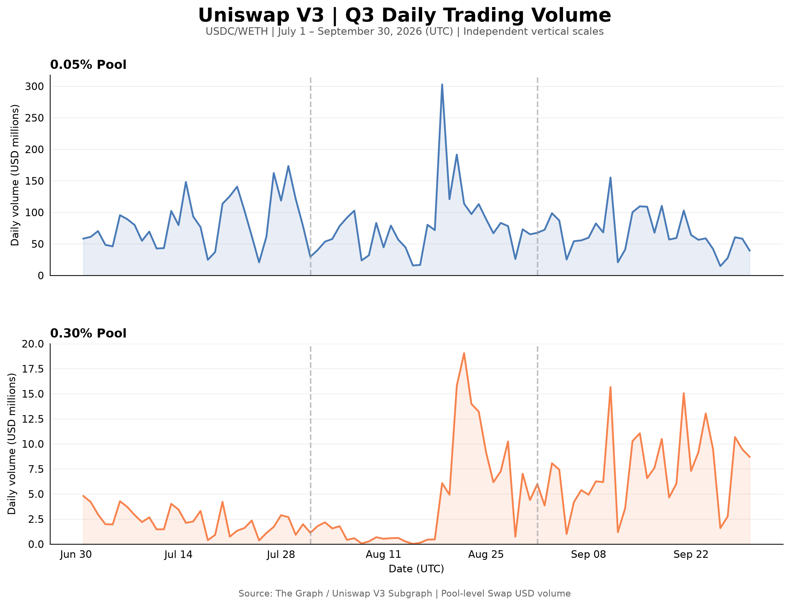
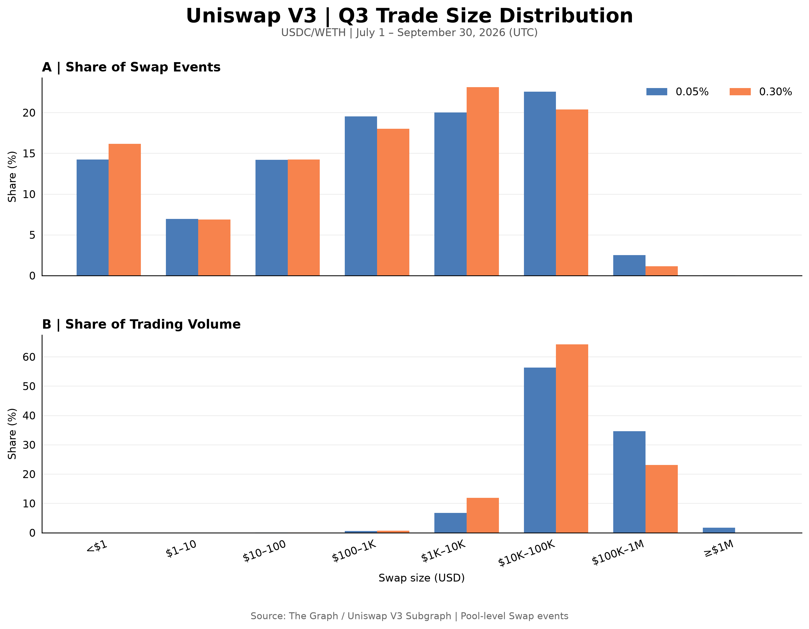
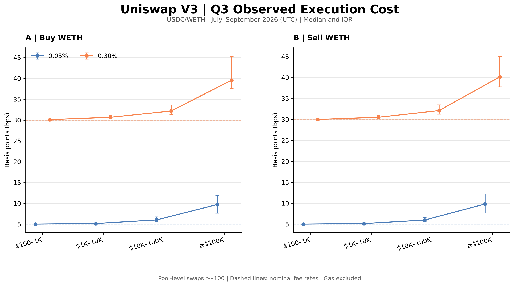
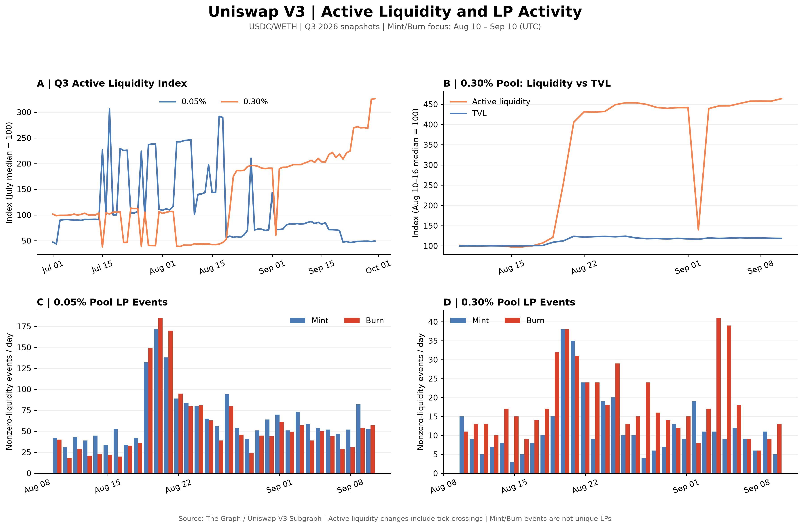
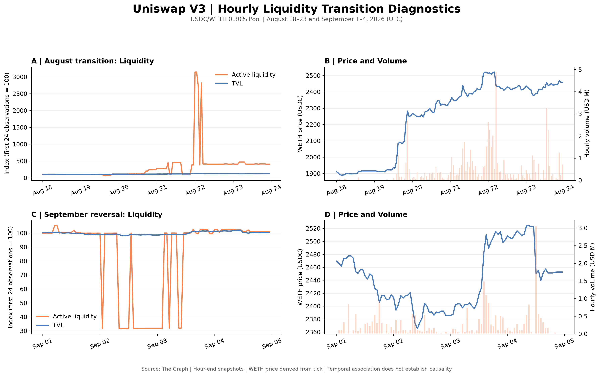
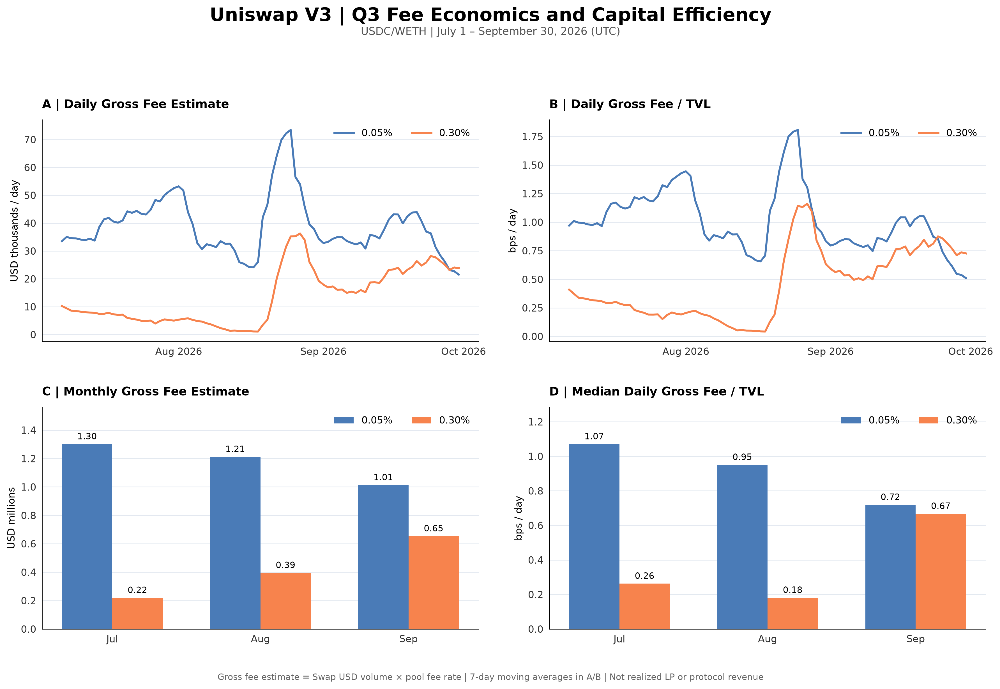
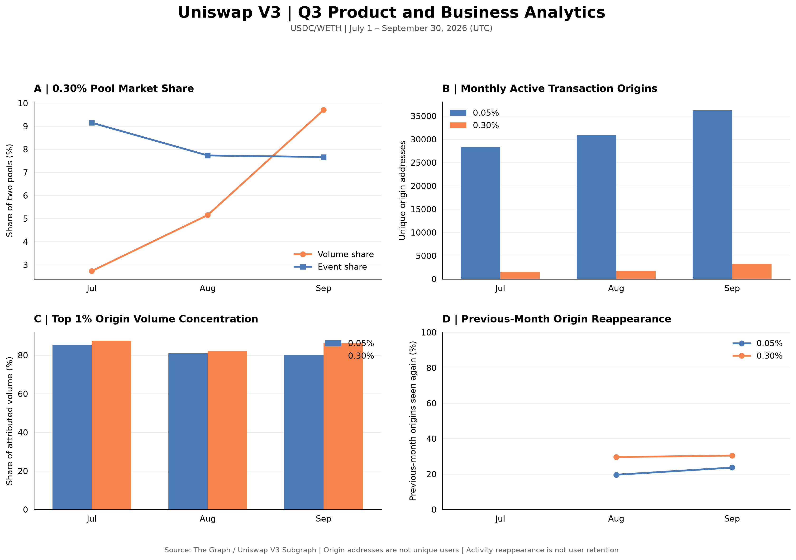
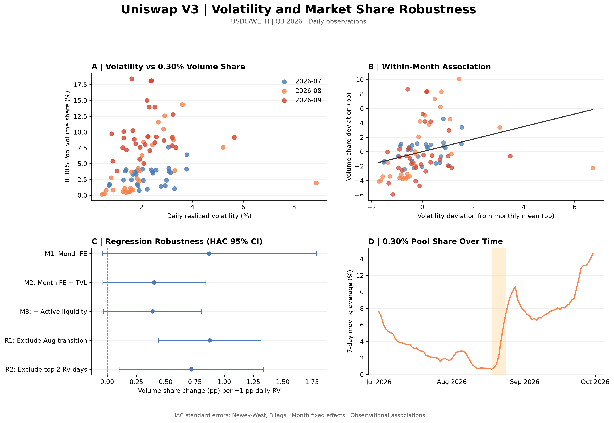

# Trading and Liquidity in Uniswap V3 USDC/WETH Pools

I examined trading activity in the 0.05% and 0.30% Uniswap V3 USDC/WETH pools from July through September 2026. I examined how trading volume, execution costs, liquidity and fee generation differed between the two pools. I also studied a change in the 0.30% pool's activity during August.

The dataset contains 581,454 Swap events over 92 days. Combined trading volume was $7.47 billion. All 184 daily pool partitions passed the data checks. I found no duplicate event IDs. The largest difference between daily Swap volumes and the subgraph's daily totals was 0.202%.

The data come from the Uniswap V3 Subgraph through The Graph. Each observation represents a Swap event in one pool. One transaction can produce more than one event. The market share figures compare only these two pools.

## Trading activity

The 0.05% pool handled most of the trading volume throughout the quarter. Its total Q3 volume was $7.05 billion, compared with $422.19 million in the 0.30% pool. The 0.30% pool gained volume share each month.

| Month | 0.05% volume | 0.30% volume | 0.30% volume share |
|---|---:|---:|---:|
| July | $2.60B | $73.0M | 2.73% |
| August | $2.42B | $131.6M | 5.15% |
| September | $2.03B | $217.7M | 9.70% |

The 0.30% pool's share of Swap events fell from 9.15% in July to 7.67% in September. Its share of trading volume rose over the same period. Average Swap size increased from about $4,943 to $11,510. This suggests that larger trades were an important part of its volume growth. Trades between $10,000 and $100,000 made up more than half of the volume in both pools.

## Execution costs

I estimated the cost of each Swap using its execution price and the pool price immediately before the event. The reference price came from the previous recorded Swap's closing pool state. This measure includes the pool fee and the effect of the trade on the pool price. It excludes gas, routing costs and MEV. I used 374,935 events with a value of at least $100.

For WETH purchases, the median observed cost increased with trade size in both pools.

| Swap size | 0.05% pool | 0.30% pool |
|---|---:|---:|
| $100 to $1K | 5.02 bps | 30.12 bps |
| $1K to $10K | 5.16 bps | 30.66 bps |
| $10K to $100K | 6.03 bps | 32.18 bps |
| Above $100K | 9.72 bps | 39.59 bps |

I also removed each pool's nominal fee to study the remaining execution price difference. For WETH purchases between $10,000 and $100,000, the median fee adjusted penalty in the 0.30% pool fell from 3.116 bps in July to 1.548 bps in September. The corresponding figure in the 0.05% pool rose from 0.938 to 1.147 bps.

The 0.30% pool showed an improvement in this measure, but its total observed cost remained higher. The two pools also handled different orders at different times. These results do not show which pool would have given a better quote for the same order at the same moment.

## Liquidity changes in August

The 0.30% pool's average TVL increased from $256.47 million in July to $312.53 million in September. Its active liquidity changed much more sharply. Active liquidity measures the liquidity available at the current price range in Uniswap V3. Its raw value is not a dollar amount, so I expressed it as an index based on each pool's July median.

In the 0.30% pool, the median active liquidity index rose from 43.24 during August 10 to 16 to 194.03 during August 24 to 30. Over these two periods, median TVL increased by 19.6%, while median daily trading volume share rose from 0.80% to 8.76%.

I looked more closely at August 19 to 22. The pool's price tick moved substantially. Mint and Burn activity also increased. On August 20, there were 38 Mint events and 38 Burn events with nonzero liquidity amounts in the 0.30% pool.

Hourly data showed even sharper changes. Active liquidity increased by 719.28% in one hour on August 22. It also dropped and recovered rapidly on several occasions in late August and early September. TVL moved much less during these changes.

These results are consistent with the way concentrated liquidity works. Liquidity can enter or leave the active price range when the price crosses a tick. LPs can also move their positions. I could not isolate the contribution of each mechanism from the daily and hourly snapshots alone. That would require reconstructing pool states at the relevant blocks.

## Fees and capital efficiency

The 0.05% pool had much higher trading volume relative to TVL. However, the 0.30% pool charges six times the nominal fee rate. I estimated gross fees by multiplying observed Swap volume by each pool's fee rate.

| Month | 0.05% gross fees | 0.30% gross fees | 0.30% share of gross fees |
|---|---:|---:|---:|
| July | $1.30M | $0.219M | 14.4% |
| August | $1.21M | $0.395M | 24.6% |
| September | $1.01M | $0.653M | 39.2% |

The median daily gross fee estimate per unit of TVL was 0.719 bps for the 0.05% pool and 0.667 bps for the 0.30% pool in September. This gap was much smaller than in July, when the figures were 1.070 and 0.262 bps.

These are gross fee estimates. They are not LP profits or realized protocol revenue. LP returns also depend on fee distribution, time spent within the active price range, changes in asset prices and the costs of managing positions.

## Address activity

I used the transaction origin field to measure address activity. In the 0.30% pool, the number of distinct monthly origin addresses increased from 1,519 in July to 3,253 in September. Trading volume remained concentrated. The top 1% of origin addresses accounted for 86.24% of the pool's attributed volume in September.

The share of distinct addresses that appeared in both studied pools rose from 3.05% in July to 4.85% in September. These figures describe onchain addresses, not individual users. A person or trading service can use multiple addresses. I therefore do not treat address counts as customer counts or monthly reappearance as user retention.

## Volatility and market share

I calculated daily realized volatility from hourly WETH prices in the 0.05% pool. I divided the 92 days into three groups using volatility thresholds of 1.650% and 2.403%. The 0.30% pool had a higher median daily volume share on more volatile days.

| Volatility group | 0.30% median daily volume share | 0.30% median daily turnover |
|---|---:|---:|
| Low | 2.42% | 0.003 |
| Medium | 4.66% | 0.012 |
| High | 7.60% | 0.021 |

I then ran daily regressions with month controls. I also included relative TVL and active liquidity in separate specifications. Standard errors used the Newey West method with three lags.

| Model | Volatility coefficient | p-value |
|---|---:|---:|
| Month controls | 0.872 | 0.0614 |
| Add relative TVL | 0.402 | 0.0734 |
| Add active liquidity | 0.387 | 0.0691 |
| Exclude August 18 to 23 | 0.875 | 0.0001 |
| Exclude the two most volatile days | 0.719 | 0.0226 |

A one percentage point rise in daily realized volatility corresponded to a positive change in the 0.30% pool's volume share in each specification. The three main models did not reach the 5% significance level. The two models using smaller samples did. The relationship is positive in this dataset, but the estimated strength depends on the specification and sample.

These regressions use only 92 daily observations. Volatility, liquidity and trading activity can change together because of the same market events. The estimates show an association, not a causal effect.

## Conclusion

The 0.05% pool remained the larger market throughout Q3. The 0.30% pool gained trading volume share, handled larger average swaps and generated a growing share of estimated gross fees. It also experienced a major change in active liquidity during August. Its observed fee adjusted execution penalty declined over the quarter, although its total execution cost remained higher than that of the 0.05% pool.

The evidence suggests a change in the way traders and liquidity interacted with the 0.30% pool. It does not identify a single cause. A useful next step would be to reconstruct pool states at the same historical blocks and compare quotes for identical orders across the two pools. This would help separate execution quality from changes in the mix of trades.
